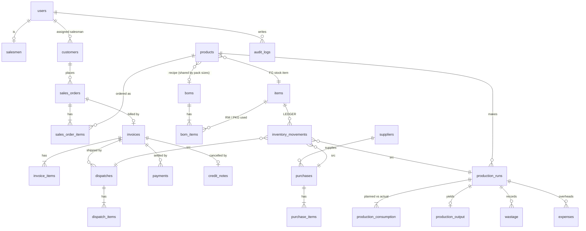

# Design note — Order-to-Audit Management System

## 1. Data model (SQLite, 36 tables/views; full DDL in `app/db.py`)

Key relationships: **items** is the single stock-keeping table (kind `RM`, `PKG`, `FG`); a **product** points to its FG item and to a **BOM**, so a new pack size (e.g. Murukku 500 g) is one product row + one item row sharing the same `bom_id`. Every stock-changing document writes rows to **inventory_movements** with `src_type`/`src_id`/`ref_no`, so each movement traces back to a purchase, production run, dispatch (invoice) or adjustment.

## 2. Stock calculation
* The ledger is **append-only** (triggers reject UPDATE/DELETE). Quantities are integers in thousandths of the item's base unit; money is integer paise → no floating point anywhere.
* `stock_balances` is a **view**: `SUM(qty_in − qty_out)` and `SUM(value)` per item, so balances cannot drift or be overwritten. Closing = Opening + Receipts − Issues ± Adjustments; the stock ledger report adds a running balance with a window function.
* Issues that exceed the balance raise `InsufficientStock` and roll the whole transaction back (`BEGIN IMMEDIATE`, nested work uses SAVEPOINTs).

## 3. BOM consumption
`planned = convert(bom_qty, bom_unit → item_base_unit) × batches` (unit table: kg/g, L/ml, pc, packet/carton=20 packets; cross-dimension conversion is refused). Expected output = `bom.expected_output × batches`. Run lifecycle: **create** (RM issued, `PRODUCTION_ISSUE`) → **complete** (pouches/cartons `PRODUCTION_CONSUME`, damaged pouches `WASTAGE`, finished goods `PRODUCTION_RECEIPT` at material cost) → **overheads** added.

## 4. Variance
`material var % = (actual − planned) / planned × 100`; `yield var % = (actual − expected) / expected × 100`; `wastage % = max(expected − actual, 0) / expected × 100`. A row is flagged when |var %| **>** the tolerance stored on the run (default 3 %, editable in Settings, snapshot per run so history is stable).

## 5. Inventory valuation & costing
* **Valuation: perpetual weighted-average cost.** Receipt adds value; issue = pool value ÷ pool qty × issued qty (the last unit takes the remaining value). Flour: 100 kg @ ₹42 + 60 kg @ ₹45 → ₹43.125/kg.
* **Run cost** = RM issued + packaging consumed (good + damaged) + overheads assigned to the run. **Cost/packet = total ÷ good packets** (losses are absorbed by good output, not hidden). Overheads are charged 100 % to the run they are recorded against. FG stock is carried at material + packaging cost (overheads shown in the costing report, not capitalised).

## 6. GST
Place of supply state code vs seller state code (33): equal → CGST + SGST (each half), different → IGST. Per-line integer-paise rounding (half-up). FY invoice numbers `INV/2026-27/0001` from a per-FY sequence. Posted invoices are immutable (triggers); corrections = cancellation + credit note (+ goods returned to stock).
